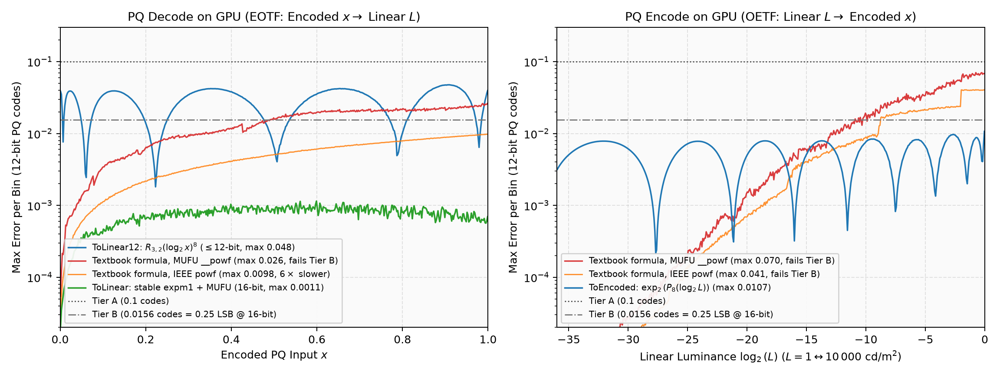

# Algorithm & Color Science

This document explains the mathematical formulation of 4:2:0 chroma subsampling as an inverse problem, the reference algorithm in `libwebp`'s `sharpyuv`, the algorithmic improvements introduced in `sharpyuv-cuda`, and the numerical design of the transfer functions. For GPU execution details, see [CUDA Kernel Architecture](KERNEL.md).

---

## 1. Problem Definition

### 1.1 Color Science Basics & ITU-T H.273

An encoded video or image signal is described by three independent colorimetric stages standardized in ITU-T H.273 (ISO/IEC 23091-2):

1. **Color Primaries (`ColourPrimaries`, CP):**
   Define the CIE 1931 $(x, y)$ chromaticity coordinates of the red, green, and blue primaries and the reference white point. Together they determine the $3 \times 3$ linear matrix mapping linear RGB $(R, G, B) \in [0, 1]^3$ to CIE XYZ tristimulus values. The middle ($Y$) row of this matrix gives the **linear-light luminance weights** $k_L = (k_{Lr}, k_{Lg}, k_{Lb})$ with $k_{Lr} + k_{Lg} + k_{Lb} = 1$:
   $$L_{\text{lin}} = k_{Lr} R + k_{Lg} G + k_{Lb} B$$
   $L_{\text{lin}}$ is physical luminance — the quantity the human visual system perceives with high spatial acuity.

2. **Transfer Characteristics (`TransferCharacteristics`, TC):**
   Define the non-linear opto-electronic transfer function (OETF, $\text{ToEncoded}$) and its inverse electro-optical transfer function (EOTF, $\text{ToLinear}$) mapping between linear light $(R, G, B)$ and non-linear transfer-encoded components $(R', G', B') \in [0, 1]^3$.
   - For SDR and PQ, the transfer curve applies per channel.
   - For HLG (ARIB STD-B67 / Rec. ITU-R BT.2100), display rendering includes a system opto-optical transfer function (OOTF) that couples all three channels via scene luminance.

3. **Matrix Coefficients (`MatrixCoefficients`, MC):**
   In non-constant-luminance (NCL) $Y'CbCr$ systems, luma $Y'$ and chroma $(Cb, Cr)$ are formed as a linear combination of **transfer-encoded** $(R', G', B')$ using matrix weights $k_M = (k_{Mr}, k_{Mg}, k_{Mb})$ with $k_{Mr} + k_{Mg} + k_{Mb} = 1$:
   $$Y' = k_{Mr} R' + k_{Mg} G' + k_{Mb} B'$$
   $$Cb = \frac{B' - Y'}{2(1 - k_{Mb})} = u_{\text{coef}} (B' - Y'), \qquad Cr = \frac{R' - Y'}{2(1 - k_{Mr})} = v_{\text{coef}} (R' - Y')$$

Crucially, **CP and MC are not always equal** (for example, JPEG and WebP commonly pair BT.709/sRGB primaries with a BT.601 matrix, and HDR pipelines often pair Display P3 primaries with a BT.2020 NCL matrix).

### 1.2 Why Naive 4:2:0 Subsampling Fails at Sharp Edges

In YUV 4:2:0, luma $Y'$ is stored at full resolution ($W \times H$) while chroma $(Cb, Cr)$ is subsampled to half resolution along both axes ($\lceil W/2 \rceil \times \lceil H/2 \rceil$, one sample per $2 \times 2$ pixel block).

A naive 4:2:0 converter computes $(Y', Cb, Cr)$ independently at each pixel and averages the four $Cb$ and $Cr$ values of each $2 \times 2$ block. When a decoder displays the image, it upsamples $(Cb, Cr)$ back to full resolution via an upsampling filter $\mathcal{U}$ (such as bilinear interpolation or nearest-neighbor replication) and inverts the $Y'CbCr$ matrix:
$$\widehat{\text{RGB}}'(x, y) = \text{clamp}_{[0,1]}\!\left( Y'(x, y) + M_{\text{chroma}}^{-1}\!\left(\mathcal{U}(Cb)(x, y),\; \mathcal{U}(Cr)(x, y)\right) \right)$$

At sharp, saturated color boundaries and thin colored strokes, naive 4:2:0 fails for three reasons:
1. **Non-linear chroma averaging:** Averaging transfer-encoded $(Cb, Cr)$ in gamma/PQ space instead of linear light underestimates energy and shifts hue across high-contrast boundaries.
2. **Luminance-chroma cross-talk (non-constant luminance):** Because $Y'$ is formed in non-linear space while physical luminance $L_{\text{lin}}$ is formed in linear light, substituting smoothed chroma $\mathcal{U}(Cb, Cr)$ next to the original $Y'$ alters the decoded linear luminance $k_L \cdot \text{ToLinear}(\widehat{\text{RGB}}')$, producing visible **dark fringes** at saturated edges.
3. **Unmodeled decoder upsampler:** Naive box downsampling ignores how the decoder's upsampling kernel $\mathcal{U}$ spreads a block's chroma into neighboring blocks (and vice versa), causing color bleeding and phase shifts when chroma is co-sited.

### 1.3 The Inverse Problem Formulation

Sharp YUV treats 4:2:0 conversion as an **inverse problem** parameterized by the decoder's chroma upsampler $\mathcal{U}$ and target filter $\mathcal{T}$. Given source pixels $\text{RGB}'_{\text{src}}$, find full-resolution luma $Y'$ and half-resolution chroma $(Cb, Cr)$ such that the **reconstructed image** $\widehat{\text{RGB}}' = \text{Decode}(Y', \mathcal{U}(Cb, Cr))$ satisfies two conditions simultaneously:

1. **Per-pixel linear-light luminance preservation:** At every pixel $(x, y)$,
   $$k_L \cdot \text{ToLinear}\!\left(\widehat{\text{RGB}}'(x, y)\right) = k_L \cdot \text{ToLinear}\!\left(\text{RGB}'_{\text{src}}(x, y)\right)$$
2. **Per-block linear-light color preservation:** At every $2 \times 2$ block $(b_x, b_y)$, the filtered linear-light color of the reconstruction matches that of the source:
   $$\mathcal{T}\!\left(\text{ToLinear}(\widehat{\text{RGB}}')\right)(b_x, b_y) = \mathcal{T}\!\left(\text{ToLinear}(\text{RGB}'_{\text{src}})\right)(b_x, b_y)$$

---

## 2. `libwebp` Design

`libwebp`'s `sharpyuv` introduced a practical iterative fixed-point solver for this inverse problem.

### 2.1 The $W + d$ Parameterization

Instead of iterating directly on quantized $(Y', Cb, Cr)$, `libwebp` works in an equivalent **"luma proxy + RGB chroma offset"** representation:
- **`W` (`best_y`, full resolution $W \times H$):** Per-pixel gamma-space luma proxy.
- **`d` (`best_uv`, half resolution $W_c \times H_c \times 3$):** Per-$2 \times 2$-block RGB offsets $d = (d_r, d_g, d_b) = (r' - W_{\text{blk}},\, g' - W_{\text{blk}},\, b' - W_{\text{blk}})$.

Under a decoder upsampler $\mathcal{U}$, a pixel is reconstructed per channel as:
$$\widehat{\text{RGB}}'(x, y) = \text{clip}\!\left( W(x, y) + \mathcal{U}(d)(x, y) \right)$$
Because the $Cb$ and $Cr$ rows of any $Y'CbCr$ matrix sum to zero ($M_{Cb} \cdot (1, 1, 1)^T = 0$), adding the scalar $W(x, y)$ to all three RGB channels cancels out in $Cb$ and $Cr$. Thus $d$ alone determines $(Cb, Cr)$.

### 2.2 Fixed-Point Iterative Refinement

`libwebp` executes up to 4 error-feedback (Landweber-style) passes in 10–14-bit fixed-point arithmetic:
1. **Targets:** Compute per-pixel target luminance $W_t(x, y) = \text{LinearToGamma}(\text{Gray}(\text{GammaToLinear}(\text{RGB}'_{\text{src}})))$ and per-block target chroma offsets $d_t$ from the $2 \times 2$ box average in linear light.
2. **Iteration:** In each pass, upsample $d$ with the centered bilinear (`9-3-3-1`) filter, reconstruct $\widehat{\text{RGB}}' = \text{clip}(W + \mathcal{U}(d))$, measure its encoded linear luminance $W_{\text{rec}}$ and block chroma $d_{\text{rec}}$, and update:
   $$W \leftarrow \text{clip}\!\left(W + (W_t - W_{\text{rec}})\right), \qquad d \leftarrow d + (d_t - d_{\text{rec}})$$
3. **Final YUV export:** Convert $W + d_{\text{nearest}}$ to $Y'$ and $d$ to $(Cb, Cr)$.

### 2.3 Limitations of the `libwebp` Implementation

While effective for 8-bit sRGB WebP images, `libwebp`'s implementation has several colorimetric and numerical limitations:
- **Single hardcoded `Gray()` weight:** `libwebp` uses hardcoded Rec.709 weights $(0.2126, 0.7152, 0.0722)$ for *both* linear-light luminance and gamma-space luma decomposition, regardless of the actual color primaries or output $Y'CbCr$ matrix. When MC is Rec.601, $k_M \cdot d \ne 0$, so $d$ leaks into $Y'$.
- **Nearest-neighbor chroma in final $Y'$:** In the final export step, `libwebp` computes $Y'$ from $W + d_{\text{own\_block}}$ (nearest) rather than $W + \mathcal{U}(d)$, which only approximately matches the bilinearly upsampled image that the iteration optimized.
- **Chroma windup under clipping:** When reconstructed RGB clips to $[0, 1]$ at saturated boundaries, $d_{\text{rec}}$ cannot reach $d_t$, and the unclipped update $d \leftarrow d + (d_t - d_{\text{rec}})$ accumulates unboundedly. When the final quantizer clamps $Cb/Cr$ to the output code range, the decoder sees different chroma than the solver assumed, causing error to diverge after 2–4 iterations.
- **Fixed-point & LUT quantization:** 16-bit fixed-point linear light and a 9-bit `LinearToGamma` lookup table introduce quantization noise in smooth gradients and lack dynamic range for HDR PQ.
- **Hardcoded centered bilinear upsampler:** Only models H.273 `center` siting with a $2 \times 2$ box target; co-sited video (`left` / `top-left`) and nearest-neighbor decoders are not modeled.
- **Sequential Gauss-Seidel row sweep:** Updating `best_uv` in-place from top to bottom creates vertical row-to-row serial dependencies.

---

## 3. `sharpyuv-cuda` Tweaks & Algorithmic Improvements

`sharpyuv-cuda` preserves the core error-feedback formulation while redesigning the color science, solver mathematics, and feature set.

### 3.1 Separating Linear Luminance (CP) from Gamma Luma (MC)

`sharpyuv-cuda` splits `Gray()` into two distinct weight vectors:

| Vector | Space | Source | Role |
|---|---|---|---|
| $k_L = (k_{Lr}, k_{Lg}, k_{Lb})$ | Linear light | **Color Primaries (CP)** | Defines physical luminance $L_{\text{lin}} = k_L \cdot \text{RGB}_{\text{lin}}$ preserved at every pixel ($W_t$ and $W_{\text{rec}}$). |
| $k_M = (k_{Mr}, k_{Mg}, k_{Mb})$ | Transfer-encoded | **Matrix Coefficients (MC)** | Initializes $W^{(0)} = k_M \cdot \text{RGB}'_{\text{src}}$ and decomposes block colors into chroma offsets $d = \text{RGB}' - (k_M \cdot \text{RGB}')$. |

Because every chroma offset $d$ is constructed using $k_M$, it satisfies the exact orthogonality identity:
$$k_M \cdot d = k_{Mr} d_r + k_{Mg} d_g + k_{Mb} d_b = 0$$
By linearity, any upsampled chroma $\mathcal{U}(d)$ also satisfies $k_M \cdot \mathcal{U}(d) = 0$. Therefore:
1. **Exact final $Y'$ without chroma:** The $Y'$ that reconstructs $W + \mathcal{U}(d)$ under the $Y'CbCr$ matrix is $k_M \cdot (W + \mathcal{U}(d)) = W + k_M \cdot \mathcal{U}(d) = W$. Final $Y'$ is simply quantized directly from $W$, eliminating `libwebp`'s nearest-chroma approximation.
2. **2-float chroma state:** Because $k_M \cdot d = 0$, the green offset is uniquely determined by red and blue:
   $$d_g = -\frac{k_{Mr}}{k_{Mg}} d_r - \frac{k_{Mb}}{k_{Mg}} d_b$$
   The solver stores and exchanges only the 2-component vector $(d_r, d_b) = (R' - Y', B' - Y')$, cutting chroma register and shared-memory footprint by one third.

### 3.2 Parallel Jacobi Updates, Chroma Anti-Windup & Fixed Iteration Counts

- **Jacobi Iteration in `float32`:** Every $2 \times 2$ block updates from iteration $k$ to $k+1$ in parallel using double-buffered shared memory, with all values normalized to $[0, 1]$ in IEEE `float32`.
- **Chroma Anti-Windup Projection (`ProjectChroma`):**
  Let $[0, 2^n - 1]$ be the output code range of $Cb$ and $Cr$. Mapping those code bounds back through the quantizer and $u_{\text{coef}}, v_{\text{coef}}$ defines the representable box $[d_{r,\min}, d_{r,\max}] \times [d_{b,\min}, d_{b,\max}]$. After every iteration update, $d$ is projected onto this box:
  $$d_r^{(k+1)} = \text{clamp}\!\left(d_r^{(k)} + d_{t,r} - d_{\text{rec},r},\; d_{r,\min},\; d_{r,\max}\right)$$
  $$d_b^{(k+1)} = \text{clamp}\!\left(d_b^{(k)} + d_{t,b} - d_{\text{rec},b},\; d_{b,\min},\; d_{b,\max}\right)$$
  This prevents integrator windup at clipped edges, guarantees that the solver only optimizes over chroma values that the output format can actually represent, and makes error decrease monotonically with iteration count.
- **Fixed Iteration Counts per Filter:**
  Measuring step-to-step perceptual change ($\Delta E_{\text{ITP}}$) across SDR and HDR corpora shows that convergence rate is a property of the decoder filter rather than the color space or bit depth:
  - **Pure nearest (`SYC_FILTER_NEAREST`):** Each block's reconstruction depends only on its own chroma, so feedback is block-local and converges in **3 iterations**.
  - **Interpolating filters and mixtures:** Overlapping chroma footprints converge within **6 iterations** ($\le 0.16\ \Delta E_{\text{ITP}}$ from the 16-iteration fixed point across all tested color configurations).
  Using a fixed iteration count eliminates data-dependent device reductions and host-device synchronization.

### 3.3 Decoder Filter Models, Chroma Siting & Blends

Each pure decoder filter (`syc_decoder_filter`) is a separable combination of two 1-D modes (vertical and horizontal). Along each axis, a 1-D mode is one of three types:

| 1-D Mode | Upsampler Taps on Blocks $(-1, 0, +1)$ for Even Pixel (Phase 0) | Upsampler Taps on Blocks $(-1, 0, +1)$ for Odd Pixel (Phase 1) | Target / Feedback Filter Taps on Pixels $(-1, 0, +1)$ |
|---|---|---|---|
| **Nearest (Replicate)** | $(0, 1, 0)$ | $(0, 1, 0)$ | Box $(0, \tfrac{1}{2}, \tfrac{1}{2})$ |
| **Centered Bilinear** | $(\tfrac{1}{4}, \tfrac{3}{4}, 0)$ | $(0, \tfrac{3}{4}, \tfrac{1}{4})$ | Box $(0, \tfrac{1}{2}, \tfrac{1}{2})$ |
| **Co-sited Bilinear** | $(0, 1, 0)$ | $(0, \tfrac{1}{2}, \tfrac{1}{2})$ | Tent $(\tfrac{1}{4}, \tfrac{1}{2}, \tfrac{1}{4})$ |

- **Why co-sited bilinear uses a $(\tfrac{1}{4}, \tfrac{1}{2}, \tfrac{1}{4})$ target filter:** A co-sited chroma sample sits directly on pixel $0$ of the $2 \times 2$ block (`LEFT` horizontally, `TOP_LEFT` on both axes). Its bilinear footprint is centered on pixel $0$ and spans pixels $(-1, 0, +1)$ with weights $(\tfrac{1}{2}, 1, \tfrac{1}{2})$. Using a $(0, \tfrac{1}{2}, \tfrac{1}{2})$ box target would shift chroma by half a pixel; the symmetric $(\tfrac{1}{4}, \tfrac{1}{2}, \tfrac{1}{4})$ filter matches the co-sited phase.
- **2-D Tables & Weighted Filter Mixtures:**
  Taking outer products of the vertical and horizontal 1-D modes produces:
  - A $2 \times 2 \times 3 \times 3$ upsampler table `up[py][px][dy][dx]` giving the weight of neighbor block $(b_y + d_y - 1, b_x + d_x - 1)$ on pixel phase $(p_y, p_x) \in \{0, 1\}^2$. (Notice that phase $0$ never reads block $+1$ and phase $1$ never reads block $-1$, so every pixel reads at most a $2 \times 2$ subset of the $3 \times 3$ neighbor blocks.)
  - A $3 \times 3$ target filter table `tgt[oy][ox]` over pixel offsets $o_y, o_x \in \{-1, 0, +1\}$ around the block's top-left pixel.
  Because both operators are linear, a weighted mixture of filters $\{w_m, F_m\}$ with $\sum_m w_m = 1$ is simply the weighted sum of their `up` and `tgt` tables:
  $$\text{up}_{\text{mix}} = \sum_m w_m\, \text{up}_m, \qquad \text{tgt}_{\text{mix}} = \sum_m w_m\, \text{tgt}_m$$
  Optimizing against the averaged table closely matches optimizing the weighted average residual across separate decoder models, while requiring only **one** reconstruction per iteration.

### 3.4 HLG and the BT.2100 Display OOTF

Standard HDR HLG (ARIB STD-B67 / Rec. ITU-R BT.2100) is a scene-referred signal whose display rendering includes the BT.2100 opto-optical transfer function (OOTF):
$$F_D = \alpha \, Y_s^{\gamma - 1} E_s + \beta, \qquad Y_s = k_{Lr} E_{s,R} + k_{Lg} E_{s,G} + k_{Lb} E_{s,B}$$
where $E_s = \text{OETF}^{-1}(\text{RGB}')$ is normalized scene-linear light and $\gamma = 1.2$ for the nominal $1000\text{ cd/m}^2$ reference display.

Averaging HLG colors in scene light $E_s$ ignores the display nonlinearity $Y_s^{\gamma - 1}$. `sharpyuv-cuda` models the exact BT.2100 OOTF (with normalized peak $\alpha = 1$ and black lift $\beta = 0$, which cancel out in ratios and averages):
- **To display linear light (`ToLinear`):**
  $$E_s = \text{OETF}^{-1}(\text{RGB}'), \qquad Y_s = k_L \cdot E_s, \qquad F_D = Y_s^{\gamma - 1} E_s$$
- **Back to encoded HLG (`ToEncoded`):**
  $$Y_D = k_L \cdot F_D = Y_s^\gamma, \qquad E_s = Y_D^{(1 - \gamma)/\gamma} F_D, \qquad \text{RGB}' = \text{OETF}(E_s)$$
- **Achromatic luminance encoding (`EncodeLuminance`):**
  $$W = \text{OETF}\!\left(Y_D^{1/\gamma}\right)$$

Modeling the display OOTF weights brighter pixels by $Y_s^{0.2}$ during block chroma averaging, preventing desaturation and luminance shifts along high-contrast HDR highlights and colored edges.

### 3.5 Alpha-aware Optimization & 1-Ring Inpainting

When an image with straight (unassociated) alpha is composited over a background $B$, each pixel contributes $\alpha \cdot C + (1 - \alpha) \cdot B$. In regions where $\alpha = 0$, the RGB channels are invisible (often filled with black $(0, 0, 0)$). Under standard 4:2:0 conversion or unweighted Sharp YUV, that hidden black colour is averaged into edge chroma blocks and interpolated by the decoder's bilinear upsampler into adjacent visible pixels ($\alpha > 0$), creating a dark halo around cut-outs.

*(Note: Premultiplied 4:2:0 cannot solve this problem because transparent pixels must decode to $(0, 0, 0)$, leaving no freedom to match chroma across the boundary without adding a colored glow to the background.)*

When an alpha-enabled `syc_channel_interpretation` is selected, `sharpyuv-cuda` applies a 5-step alpha-aware algorithm:

1. **$\alpha$-Weighted Block Color:**
   For each pixel $(o_y, o_x)$ in a block's target window, its effective weight is $q(o_y, o_x) = w_{\text{tgt}}(o_y, o_x) \cdot \alpha(o_y, o_x)$. If $S = \sum q > 0$, the block's initial linear color is the $\alpha$-weighted average:
   $$C_{\text{blk}} = \frac{1}{S} \sum_{o_y, o_x} q(o_y, o_x)\, \text{ToLinear}\!\left(\text{RGB}'_{\text{src}}(o_y, o_x)\right)$$
2. **1-Ring Empty-Block Inpainting:**
   A block with $S = 0$ (all pixels in its window have $\alpha = 0$) is **empty**. Because a bilinear chroma sample only influences its $3 \times 3$ neighborhood of blocks, only the **first ring** of empty blocks adjacent to non-empty blocks can ever bleed into visible pixels. Each empty block that has at least one non-empty $3 \times 3$ neighbor replaces its $C_{\text{blk}}$ with the mean linear color of those non-empty neighbors:
   $$C_{\text{blk}}^{\text{inp}} = \frac{1}{|\mathcal{N}_{\text{vis}}|} \sum_{b' \in \mathcal{N}_{\text{vis}}} C_{b'}$$
   This single non-iterative $3 \times 3$ stencil achieves the same visible rim quality as full multi-pass inpainting, regardless of mask complexity. (For `SYC_FILTER_NEAREST`, there is no inter-block chroma bleed, so this step is skipped.)
3. **Interior Empty Blocks:**
   Empty blocks with no visible $3 \times 3$ neighbors do not affect any visible pixel and keep their unweighted color.
4. **$\alpha$-Weighted Chroma Feedback:**
   During Jacobi iterations, non-empty blocks compute their reconstructed chroma feedback using the normalized weights $q / S$. Empty blocks ($S = 0$) receive no feedback and keep their inpainted chroma target $d_t = \text{ChromaOffsets}(C_{\text{blk}}^{\text{inp}})$.
5. **Smooth Luma Fill Under $\alpha = 0$:**
   Visible pixels ($\alpha > 0$) keep their exact source luminance target $W_t$. Fully transparent pixels ($\alpha = 0$) have no visible source luminance; their $W_t$ and initial $W^{(0)}$ are set to the encoded luminance of the upsampled linear block colors $\mathcal{U}(C_{\text{blk}}^{\text{inp}})$, eliminating artificial sharp luma edges under transparency.

---

## 4. Transfer Function Approximation Details

Inside the GPU kernel (`src/transfer.cuh`), transfer functions are evaluated millions of times per frame. To evaluate accuracy consistently across curves and bit depths, errors are measured in **12-bit transfer-encoded code units** ($\times 4095$):
- **Encode (`ToEncoded`):** $e_{\text{enc}}(L) = 4095 \cdot \left|\widehat{\text{OETF}}(L) - \text{OETF}_{\text{fp64}}(L)\right|$.
- **Decode (`ToLinear`):** $e_{\text{dec}}(x) = 4095 \cdot \left|\text{OETF}_{\text{fp64}}\!\left(\widehat{\text{EOTF}}(x)\right) - \text{OETF}_{\text{fp64}}\!\left(\text{EOTF}_{\text{fp64}}(x)\right)\right|$, which measures linear-light errors in the perceptual encoded domain where quantization occurs.

Two accuracy tiers are defined:
- **Tier A ($\le 0.1$ 12-bit codes):** $\le 0.1\text{ LSB}$ at 12-bit ($\le 0.025\text{ LSB}$ at 10-bit), well below quantization for 8-, 10-, and 12-bit outputs.
- **Tier B ($\le 0.0156$ 12-bit codes):** $\le 0.25\text{ LSB}$ at 16-bit, suitable for full 16-bit outputs.

### 4.1 Parametric SDR Curves (`sRGB`, `BT.709`, Custom) and HLG

For parametric curves (`ParamToLinear`, `ParamToEncoded`) and HLG (`hlg::InvOetf`, `hlg::Oetf`), CUDA's hardware Special Function Unit (MUFU) intrinsics (`__powf`, `__expf`, `__logf`, and inline `rsqrt.approx.ftz.f32`) achieve **Tier B** accuracy directly:
- `sRGB` decode / encode max error: $7.6 \times 10^{-4}$ codes.
- `BT.709` decode / encode max error: $6.9 \times 10^{-4}$ codes.
- `HLG` decode / encode max error: $3.9 \times 10^{-4}$ codes.

For how piecewise branches and denormal guards are handled in the kernel to avoid warp divergence, see [CUDA Kernel Architecture — Device Transfer Functions & Template Dispatch](KERNEL.md#5-device-transfer-functions--template-dispatch).

### 4.2 SMPTE ST 2084 (PQ) Numerical Conditioning & Approximations

The standard SMPTE ST 2084 (PQ) constants are:
$$m_1 = \frac{2610}{16384}, \quad m_2 = \frac{2523}{4096} \times 128, \quad c_1 = \frac{3424}{4096}, \quad c_2 = \frac{2413}{4096} \times 32, \quad c_3 = \frac{2392}{4096} \times 32$$

#### Why the Textbook PQ Formulas Fail in `float32`

Evaluating the textbook formulas directly in single precision loses 6–7 bits of precision near white ($x \to 1, L \to 1$):
- **Textbook EOTF:** $p = x^{1/m_2}$, $L = \left(\frac{\max(p - c_1, 0)}{c_2 - c_3 p}\right)^{1/m_1}$.
  Because $1/m_2 \approx 0.0127$, all practical code values map to $p \in [0.84, 1.0]$. Rounding $p$ to `float32` near $1.0$ and subtracting $p - c_1$ and $c_2 - c_3 p$ causes severe catastrophic cancellation:
  - With fast GPU MUFU intrinsics (`__powf`), the error reaches **$0.026$ codes**, failing Tier B ($0.0156$).
  - With full IEEE `libm` (`powf` + `fmaf`), it reaches **$0.0098$ codes** (barely within Tier B, or $0.025$ without FMA), but runs **$6\times$ slower** on the GPU ($140$ vs. $873\text{ Geval/s}$) and still has $18\times$ larger error than the stable rewrite.
- **Textbook OETF:** $y = L^{m_1}$, $x = \left(\frac{c_1 + c_2 y}{1 + c_3 y}\right)^{m_2}$.
  The rational term sits near $1.0$ and is raised to $m_2 \approx 78.8$, which amplifies `float32` rounding error by $79\times$, failing Tier B with both `libm` (**$0.041$ codes**) and MUFU intrinsics (**$0.070$ codes**).

#### 1. Numerically Stable PQ Decode (`pq::ToLinear`, Tier B for 16-bit Output)

The PQ constants satisfy an exact rational identity (which is what ensures $\text{PQ}(1) = 1$):
$$1 - c_1 = c_2 - c_3 = A = \frac{21}{128} = 0.1640625 \quad (\text{exact in float32})$$

Let $q = x^{1/m_2} - 1 = \text{expm1}\!\left(\frac{\ln x}{m_2}\right) \in [-1, 0]$. Substituting $p = 1 + q$ eliminates the cancellation near $1$:
$$p - c_1 = (1 - c_1) + q = A + q$$
$$c_2 - c_3 p = (c_2 - c_3) - c_3 q = A - c_3 q$$
$$L = \left(\frac{\max(A + q, 0)}{A - c_3 q}\right)^{1/m_1}$$
Because $t = \frac{\ln x}{m_2}$ lies in $[-0.19, 0]$ for all non-zero PQ inputs, `pq::ToLinear` evaluates $q = \text{expm1}(t) = t \cdot P_4(t)$ via a degree-4 minimax polynomial with relative error $\le 7 \times 10^{-10}$, achieving a maximum error of **$5.4 \times 10^{-4}$ 12-bit codes** ($1.1 \times 10^{-3}$ with fast MUFU intrinsics — well inside Tier B).

#### 2. Fast Rational PQ Decode (`pq::ToLinear12`, Tier A for $\le 12$-bit Output)

For 8-, 10-, and 12-bit outputs (`TfKind::kPq12`), `sharpyuv-cuda` replaces the two transcendental evaluations of `pq::ToLinear` with a minimax rational approximation in $\log_2 x$ followed by 3 squarings ($k = 8$):
$$u = 0.1 \log_2(\max(x, 2^{-20})) + 1 \in [-1, 1], \qquad L \approx \left(\frac{P_3(u)}{Q_2(u)}\right)^8$$
This requires only one `__log2f`, one `__fdividef`, and 3 multiplications, achieving a maximum error of **$0.051$ 12-bit codes** (Tier A, $\le 0.013\text{ LSB}$ at 10-bit) while cutting full-kernel 4K PQ conversion time by ~20%.

#### 3. Log-Log Polynomial PQ Encode (`pq::ToEncoded`, Tier B for All Bit Depths)

Because the PQ OETF is smooth in log-log coordinates over the entire dynamic range $[2^{-40}, 1]$, `pq::ToEncoded` fits $\log_2 x$ directly as a degree-8 minimax polynomial in $\log_2 L$:
$$u = 0.05 \log_2(\max(L, 2^{-40})) + 1 \in [-1, 1], \qquad x \approx 2^{P_8(u)}$$
This uses one `__log2f`, 8 FMAs (Horner's method), and one `exp2f`, achieving **$0.0107$ 12-bit codes** (Tier B across the entire range, outperforming the textbook `float32` formula in both speed and accuracy).

